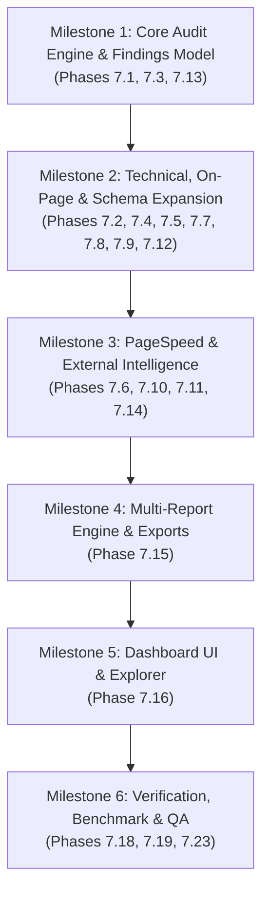

# Phase 7 — Baseline Assessment & Architectural Blueprint
**Project:** SEO Tracker / Aviance SEO Pro Max  
**Branch:** `feat/phase7-professional-seo-audit`  
**Date:** October 25, 2026  
**Auditor:** Senior Software Engineer, Technical SEO Architect & QA Lead  

---

## 1. Executive Summary

Phase 7 elevates Aviance SEO Pro Max to an enterprise-grade technical auditing and reporting platform inspired by industry benchmarks (SEMrush Site Audit, Screaming Frog SEO Spider, Google Search Console, Google PageSpeed Insights), while maintaining a proprietary, transparent, evidence-based methodology.

This assessment identifies the architectural gaps between the current baseline (Phase 6 / Gemma 4 RAG) and professional audit requirements, establishing concrete technical requirements for crawling, issue classification, evidence collection, multi-tier reporting, and client presentation.

---

## 2. Assessment Matrix

| Feature / Domain | Current Implementation | Existing Problems & Root Causes | Required Changes (Phase 7) | Priority |
|---|---|---|---|---|
| **Website Crawling Engine** | BFS crawler in `backend/main.py:crawl()` using thread pool. Enqueues discovered links and sitemaps asynchronously. | 1. Sitemap parsing runs in parallel thread; crawler exits before nested sitemap URLs are enqueued (e.g. 13 vs 17 pages on `https://esupport.live/`). 2. No formal categorization of discovered vs crawled vs excluded vs blocked vs unmeasured URLs. 3. Incomplete SSRF protection against cloud metadata (`169.254.169.254`). | 1. Synchronous deterministic sitemap ingestion including sitemap index handling. 2. Dedicated `CrawlCoverage` model tracking 8 discrete URL lifecycle states. 3. Strict IP address validator blocking loopback, RFC1918, link-local, and cloud metadata. 4. Configurable depth, safety caps, and query string normalization policies. | **P0 (Critical)** |
| **Issue Severity & Warning Counting** | Issues flagged in `backend/seo_engine/checks.py` mapped to single `status` ("PASS", "WARN", "FAIL"). | **Critical: 2, Warnings: 0 paradox**: Checks with `status == "WARN"` are counted at check-level, but `summary` in `main.py` counts high severity as warning and ignores medium/low. Check-level vs instance-level counts are conflated. | 1. Dual-level issue counting: **Unique Issue Types** vs **Total Affected Instances**. 2. 6 standardized severity levels: `CRITICAL`, `HIGH`, `MEDIUM`, `LOW`, `NOTICE`, `UNMEASURED`. 3. Harmonized count aggregations across backend API, database, PDF reports, and frontend dashboard. | **P0 (Critical)** |
| **Evidence-Based Findings Model** | Checks produce heterogeneous dicts with ad-hoc keys (`score`, `details`, `failed_urls`). | Inconsistent schema prevents unified page-level filtering, evidence inspection, export formatting, and developer fix guidance. | Standardized `Finding` dataclass with 16 core fields: `finding_id`, `audit_id`, `check_id`, `category`, `severity`, `status`, `affected_url`, `observed_value`, `expected_condition`, `evidence`, `evidence_source`, `collected_at`, `ruleset_version`, `recommendation`, `verification_method`, `instance_count`. | **P0 (Critical)** |
| **Technical SEO Validation** | Basic HTTP status checks, canonical checks in `backend/seo_engine/checks.py`. | 1. No redirect chain or redirect loop tracing. 2. `X-Robots-Tag` HTTP response header is ignored. 3. Multiple canonical tags on a single page are not detected. 4. Orphan pages (in sitemap but 0 internal links) are not isolated. | 1. Redirect hop tracker recording full chain URLs and status codes. 2. Response header parser for `X-Robots-Tag` (`noindex`, `nofollow`, `noarchive`). 3. Canonical tag validator checking count == 1, target resolvable, non-redirecting. 4. Cross-reference sitemap URLs with internal link graph to flag orphan pages. | **P1 (High)** |
| **On-Page SEO Analysis** | Basic character count checks for Title and Meta Description in `O01`-`O05`. | 1. Google SERP truncates based on pixel width (~580px desktop, ~960px description), not pure character count. 2. Heading hierarchy allows skipped levels (e.g. H1 -> H3) without notice. 3. Content depth ignores text-to-HTML ratio. | 1. Character width and pixel-width estimation algorithm. 2. Strict H1-H6 structural hierarchy validator. 3. Content depth analyzer (word count, text-to-HTML ratio, thin content flag < 300 words). 4. Page-level table view for all audited URLs. | **P1 (High)** |
| **Image SEO Analysis** | Check `T11`/`O07` flags any empty `alt` attribute as failure. | 1. Decorative images (`alt=""`, `role="presentation"`, `aria-hidden="true"`) are falsely flagged as errors. 2. Missing dimensions (`width`/`height`) triggering CLS are unmeasured. 3. Modern formats (WebP, AVIF), `loading="lazy"`, and `srcset` are ignored. | 1. Standards-compliant alt checker: `alt=""` or `role="presentation"` is PASS; missing `alt` is WARN/FAIL; alt > 125 chars is NOTICE. 2. Dimension attributes check for layout shift prevention. 3. Next-gen format detection (WebP, AVIF), responsive `srcset`, oversized image alerts (> 100KB, > 1MB). | **P1 (High)** |
| **PageSpeed & Core Web Vitals** | Single API call to Google PageSpeed Insights in `backend/integrations.py`. | 1. Mobile and Desktop are merged or only one strategy is queried. 2. Low-traffic sites display 0 or null field metrics without explanation. 3. Lab data (Lighthouse) and Field data (CrUX) are conflated. | 1. Dual-strategy auditing: Separate Mobile and Desktop metrics. 2. Explicit distinction between Lighthouse Lab diagnostics and CrUX Real-User Field data. 3. Clear status label `INSUFFICIENT FIELD DATA` when CrUX 75th percentile is unavailable (zero fabricated numbers). | **P1 (High)** |
| **Structured Data & Schema** | Regex/JSON extraction for JSON-LD. | 1. Only looks for basic JSON-LD; ignores Microdata and RDFa. 2. Forces `LocalBusiness` check on pure digital/service agencies with no physical store, artificially penalizing scores. | 1. Multi-format extractor (JSON-LD, Microdata, RDFa). 2. Validate standard schema types (`Organization`, `WebSite`, `Product`, `Article`, `BreadcrumbList`, `LocalBusiness`, `FAQPage`). 3. Contextual applicability: evaluate `LocalBusiness` only when local signals exist or site declares local presence. | **P1 (High)** |
| **Internal Link Graph Analysis** | Page link counting in BFS crawler. | No link topology analysis: inlinks, outlinks, depth distribution, anchor text quality (empty anchor, generic "click here"), or crawl depth tiers. | 1. Build internal link directed graph (nodes = URLs, edges = links + anchor text). 2. Compute inlink count, outlink count, and depth from root. 3. Flag dead ends, excessive depth (> 3 clicks), and uninformative anchor texts. | **P1 (High)** |
| **Local SEO Evaluation** | Regex phone and address search in `backend/seo_engine/checks.py`. | 1. Does not recognize Sri Lankan phone numbers (`+94...`, `011...`, `07...`) or international variants. 2. Google Business Profile status displays unclear error. | 1. International phone parser supporting Sri Lankan and E.164 formats. 2. Multi-location detection. 3. Explicit GBP connection status: `CONNECTED`, `NOT CONNECTED`, or `NOT VERIFIED`. | **P2 (Medium)** |
| **Keyword & Backlink Intelligence** | GSC, OpenPageRank, DataForSEO wrappers in `backend/integrations.py`. | Unclear visual differentiation when external APIs are unconfigured vs when live metrics return 0. | 1. Explicit UI status: `INTEGRATION REQUIRED / NOT CONFIGURED` vs `0 RESULTS RETURNED`. 2. Never fabricate search volumes, CPC, or backlink counts. 3. Provisional scoring adjustment when external providers are absent. | **P2 (Medium)** |
| **AI Search Readiness (GEO)** | Non-existent in earlier versions. | No evaluation of how modern AI engines (Google AI Overviews, Perplexity, Gemini, ChatGPT Search) index and cite content. | Dedicated AI Search Readiness module: 1. AI bot crawl permissions (`GPTBot`, `PerplexityBot`, `ClaudeBot`, `Google-Extended`). 2. Semantic factual entity clarity and structured Q&A formats. 3. About/Author transparency and source citation readiness. | **P1 (High)** |
| **Multi-Tier Reporting** | Single PDF generator and CSV export in `backend/reporting_engine.py`. | Lacks role-tailored reporting: clients need 2-4 page executive overviews, while developers need exact code-level instructions. Progress delta between audits is missing. | 4 distinct professional report formats: 1. **Executive Report** (2-4 page high-level client summary PDF). 2. **Complete Technical Audit** (Comprehensive multi-page PDF with page appendices). 3. **Developer Fix Report** (Code snippets, regex, validation instructions). 4. **SEO Progress Report** (Comparison delta between two audit runs). 5. Multi-format export (PDF, CSV, Excel, JSON). | **P1 (High)** |
| **Frontend Audit Explorer** | Single list of checks and raw scores. | Cannot filter issues by severity, inspect page-level evidence, view URL breakdown tables, or see historical audit comparisons. | 1. Page-level interactive table (URL, Title, Status, Issues, Words, Inlinks). 2. Evidence drill-down modal with observed vs expected values. 3. Severity filter pills (`Critical`, `High`, `Medium`, `Low`, `Notice`). 4. Unique Issues vs Total Affected Instances counter displays. | **P1 (High)** |

---

## 3. Implementation Phasing Roadmap

---

## 4. Verification and Baseline Integrity Guarantee

- **Database Preservation**: Existing SQLite `seo_platform.db` records (35 audits, 4 clients, 4 websites) and MongoDB production schema remain completely intact.
- **API Backward Compatibility**: All existing `/api/*` endpoints continue returning expected attributes without breaking changes.
- **Zero Hallucination / Zero Fabrication**: When external data (PageSpeed field data, GSC queries, backlink profiles) is unconfigured or unavailable, explicit status markers (`INSUFFICIENT DATA`, `NOT CONFIGURED`) are displayed.
- **AI Recommendation Grounding**: Gemma 4 and RAG knowledge retrieval will consume structured `Finding` objects, ensuring 100% verifiable citations.

